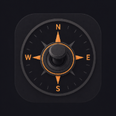
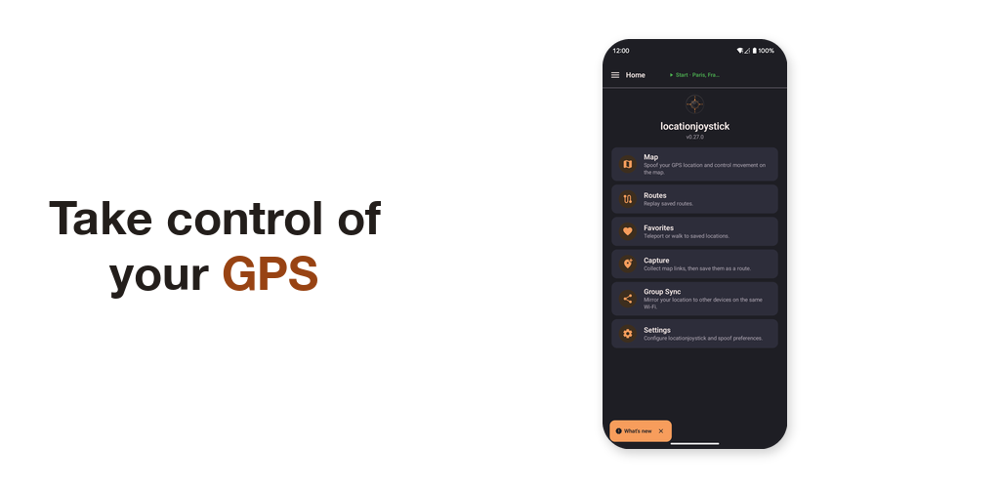
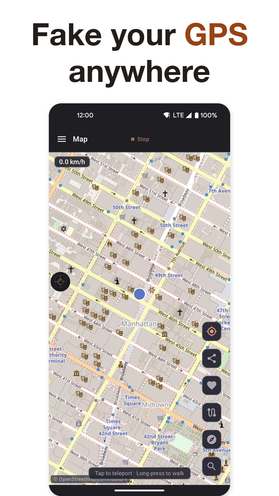
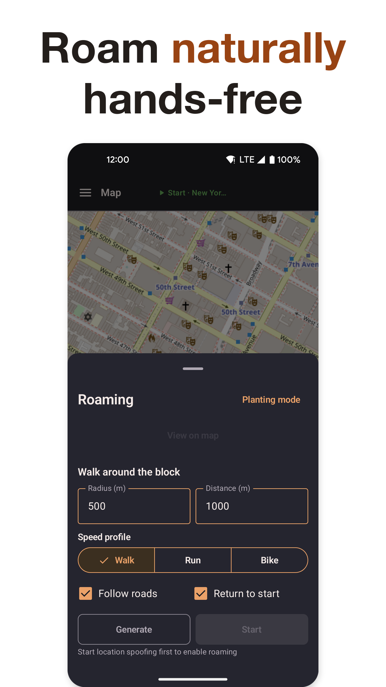
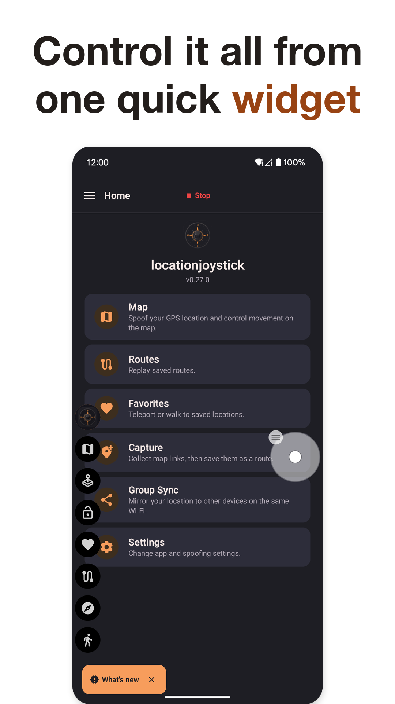
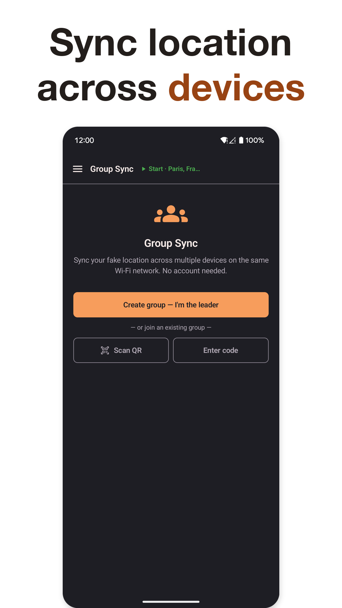

  

<h1 align="center">locationjoystick</h1>

  A free, open-source Android app that changes the location your phone reports.

  
  
  
  

  

Move a floating joystick, long-press the map to walk somewhere, replay a saved route, or let the app wander on its own. Your other apps see the new location and keep working as before.

- Free and open source. No subscription, no ads, no paid features.
- No root. The app uses the mock location option in Android's Developer Options.
- Runs in the background, so you can use other apps while it is active.
- Works offline. Your routes and favorites stay on your phone. There are no accounts.

<table>
  <tr>
    <td align="center"></td>
    <td align="center"></td>
    <td align="center"></td>
    <td align="center"></td>
  </tr>
  <tr>
    <td align="center">Map</td>
    <td align="center">Roaming</td>
    <td align="center">Floating widget</td>
    <td align="center">Group Sync</td>
  </tr>
</table>

## Features

- Move with a [floating joystick and widget](https://locationjoystick.shrtcts.fr/overlays.html) that sit on top of any app.
- Long-press the [map](https://locationjoystick.shrtcts.fr/map.html) to teleport or walk to a spot.
- Draw or import [routes](https://locationjoystick.shrtcts.fr/routes.html) and replay them. Import GPX files or paste coordinates.
- Save [favorites](https://locationjoystick.shrtcts.fr/favorites.html) and search and sort them.
- Let the app roam at random, or preview planting circles and spiral roaming.
- [Capture](https://locationjoystick.shrtcts.fr/capture.html) locations from shared map links, then save them as a route.
- Tap the game screen to walk toward that spot, without opening the app. See [Tap to Walk](https://locationjoystick.shrtcts.fr/tap-to-walk-in-a-game.html).
- Make other phones on the same Wi-Fi follow one leader phone with [Group Sync](https://locationjoystick.shrtcts.fr/group.html).
- Pick your game during setup to hide the features it does not need. See [game setup](https://locationjoystick.shrtcts.fr/game-setup.html).
- Reconnect a Bluetooth accessory when it drops. This is optional. See [reconnect accessory](https://locationjoystick.shrtcts.fr/reconnect-accessory.html).
- [Back up](https://locationjoystick.shrtcts.fr/backup-transfer.html) routes, favorites, and settings to a file. Move them to a new phone with a QR code or a short code.
- Control the app from scripts with the [Control API](https://locationjoystick.shrtcts.fr/control-api.html).

## Install

| | Google Play | GitHub APK |
|---|---|---|
| Build | Stable. The latest tested release. | Dev build. Gets changes first, with more bugs. |
| Updates | Automatic. | Manual. Download each new APK. |
| Get it | [Google Play](https://play.google.com/store/apps/details?id=com.locationjoystick.app) | [Releases page](https://github.com/shortcuts/locationjoystick/releases/latest) |

To install the APK, open the downloaded file. If Android blocks it, allow installs from unknown sources for your browser or file manager, then try again.

## Quick start

1. Install the app and open it.
2. Follow the first-run steps. They turn on mock location and pick your game.
3. Open Map, long-press a spot, and pick an action such as teleport or walk.

The [setup guide](https://locationjoystick.shrtcts.fr/) shows every step with screenshots. The [common tasks](https://locationjoystick.shrtcts.fr/tasks.html) page has short guides for teleporting, looping a route, and following a friend. If something fails, read [troubleshooting](https://locationjoystick.shrtcts.fr/troubleshooting.html).

## Community

Join the [Discord server](https://discord.gg/r9DRnkwbMf) for help, feature requests, and updates. Release notes are in the [changelog](https://locationjoystick.shrtcts.fr/changelog.html).

## Contributing

To build the app or open a pull request, read [CONTRIBUTING.md](CONTRIBUTING.md).

## License

MIT. The full text is in [LICENSE](LICENSE).
